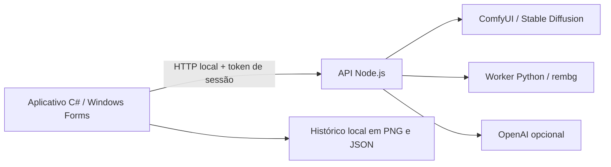

# PrismaImagem

Estúdio de imagens com IA para Windows, com interface em português, API própria e processamento local. Permite gerar imagens, transformar referências, ampliar para Full HD, recortar fundos e reconstruir uma área selecionada.

O projeto demonstra integração de modelos de visão computacional, desenvolvimento desktop em C#, construção de API em Node.js e tratamento de imagens com Python. Os modelos utilizados são de terceiros; este projeto não apresenta treinamento de um modelo próprio.

## Recursos

- Aplicativo nativo Windows Forms, sem abrir uma aba de navegador.
- Geração local com ComfyUI e Stable Diffusion 1.5.
- Transformação de referência com intensidade configurável.
- Ampliação 2× com proporções preservadas ou Full HD com corte central.
- Remoção de fundo com rembg/U²-Net e saída PNG transparente.
- Reconstrução de área marcada por máscara, com composição sobre a referência.
- Histórico com miniaturas, download PNG e restauração da versão anterior.
- Integração OpenAI opcional; chave protegida por Windows DPAPI no aplicativo desktop.

## Arquitetura



| Camada | Tecnologias |
|---|---|
| Interface desktop | C#, .NET Framework 4.8, Windows Forms |
| API | Node.js 22+, HTTP nativo, sem dependências npm |
| Geração e edição | ComfyUI, Stable Diffusion 1.5, workflows por API |
| Recorte | Python, rembg, ONNX Runtime CPU, U²-Net |
| Credenciais | Windows DPAPI CurrentUser, pipe local e token por sessão |
| Verificação | Test runner nativo do Node.js, 26 testes de contrato e fluxo |

## Executar a API e os testes

Requer Node.js 22 ou superior.

```powershell
node --test
node server.mjs
```

A alternativa web de desenvolvimento fica em `http://localhost:3000`. Para gerar localmente, o ComfyUI deve estar disponível em `127.0.0.1:8188` com um checkpoint compatível.

Variáveis opcionais estão em `.env.example`. O modo padrão é `local`. Se usar `.env`, copie o exemplo, preencha somente no computador e execute:

```powershell
node --env-file-if-exists=.env server.mjs
```

## Compilar o aplicativo Windows

Requer Windows x64, Node.js no PATH e o compilador .NET Framework do Windows:

```powershell
.\build-windows.ps1
```

O pacote é gerado em `outputs/PrismaImagem-Windows-x64.zip`. Extraia todo o pacote para uma pasta com permissão de escrita. O runtime Node é incluído pelo processo de empacotamento; modelos e ambientes de IA são instalados separadamente.

Na pasta extraída:

```powershell
.\setup-local.ps1
```

O instalador baixa o ComfyUI portátil e o checkpoint SD 1.5, verifica SHA256 e mantém os arquivos dentro da pasta do aplicativo. São aproximadamente 6 GB de downloads; reserve 20 GB para arquivos e extração. Para ativar a remoção de fundo:

```powershell
.\setup-background.ps1
```

Essa etapa baixa bibliotecas e um modelo adicionais, em pastas separadas dos pacotes do ComfyUI. Após a instalação, abra `PrismaImagem.exe`.

Se a política do computador bloquear scripts, siga as regras locais de execução. Não é necessário alterar políticas globais ou desativar proteções do Windows.

## API

| Método | Endpoint | Finalidade |
|---|---|---|
| GET | `/v1/health` | Estado do motor, modelo e configuração |
| POST | `/v1/images/generations` | Gerar imagem |
| POST | `/v1/images/edits` | Transformar, ampliar, recortar ou reconstruir |

Exemplo de corpo para geração:

```json
{
  "provider": "local",
  "prompt": "A glass house in a forest, cinematic lighting",
  "size": "1024x1024",
  "quality": "medium"
}
```

No modo local, os formatos de geração são mapeados para 512×512, 768×512 ou 512×768. A resposta informa a dimensão efetiva. Para ampliação, use `editAction: "upscale"` e `upscaleTarget: "fullhd"`, `"fullhd-portrait"` ou `"2x"`.

Contratos detalhados: [API local](API-LOCAL.md) e [guia do estúdio](GUIA-ESTUDIO.md).

## Segurança e privacidade

- API vinculada somente ao loopback; o desktop utiliza token aleatório por sessão.
- Chave OpenAI opcional armazenada com DPAPI, sem passar por argumentos de processo.
- Validação de parâmetros, tipos de imagem, tamanho de upload e origem das chamadas.
- No modo local, o fluxo de imagem utiliza processos no próprio computador.
- `.env`, chaves, históricos, imagens pessoais, logs, modelos, runtimes e pacotes gerados não fazem parte deste repositório.

O servidor de desenvolvimento não deve ser exposto à internet sem autenticação e controles adicionais. DPAPI protege a chave salva, mas não contra malware executado na mesma conta.

## Validação e limites

Os 26 testes cobrem inicialização por pipe, diagnóstico, autenticação, validações, concorrência, contratos de geração e edição, ampliação sem difusão, máscaras e composição. Os provedores de imagens são simulados nesses testes; aprovação automatizada não equivale a avaliação visual ou benchmark de qualidade.

A geração local foi utilizada em Windows com RTX 2070 de 8 GB, e o recorte de fundo foi validado pelo usuário. A reconstrução pode produzir artefatos; o SD 1.5 não equivale a modelos recentes de edição por instruções. Full HD por Lanczos aumenta a resolução, sem recuperar detalhes ausentes como um modelo de super-resolução. A seleção atual é retangular, uma área por operação.

## Estrutura

```text
desktop/                 interface C# e editor de seleção
public/                  interface web de desenvolvimento
test/                    testes automatizados
server.mjs               API e validação
local-provider.mjs       workflows ComfyUI
background-provider.mjs  execução isolada do recorte
background-worker.py     processamento com rembg
build-windows.ps1        compilação e empacotamento
setup-local.ps1          instalação do motor e checkpoint
setup-background.ps1     instalação do recorte local
```

## Modelos e componentes de terceiros

Este repositório contém o código de integração do aplicativo, sem redistribuir os pesos dos modelos. Os componentes e modelos possuem licenças próprias:

- [ComfyUI](https://github.com/Comfy-Org/ComfyUI)
- [Stable Diffusion 1.5](https://huggingface.co/stable-diffusion-v1-5/stable-diffusion-v1-5)
- [rembg](https://github.com/danielgatis/rembg)
- [Node.js](https://nodejs.org/), cujos avisos acompanham o pacote Windows

## Próximas melhorias

Seleção por pincel, avaliação visual de reconstrução, modelos locais mais avançados e comparação de qualidade e desempenho com um conjunto fixo de imagens.
